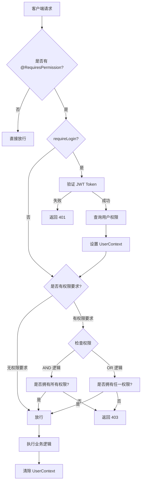

# 权限管理系统完整检查报告

## 📋 系统概述

本系统采用 **RBAC（基于角色的访问控制）** 模型，仅包含两个角色：**管理员** 和 **学生**。

---

## 👥 角色定义

### 1. 管理员 (Role ID = 1)
- **描述**: 拥有系统所有权限，可以管理用户、题目、比赛等
- **权限范围**: 所有权限（通过 `role_permission` 表关联所有权限记录）

### 2. 学生 (Role ID = 2)
- **描述**: 可以做题、参加比赛和查看自己的提交记录
- **权限范围**: 仅基础查看和提交权限

---

## 🔐 权限清单

### 用户管理模块 (user)
| 权限代码 | 权限名称 | 说明 | 管理员 | 学生 |
|---------|---------|------|--------|------|
| user:create | 创建用户 | 新增用户账号 | ✅ | ❌ |
| user:list | 查看用户列表 | 获取用户列表 | ✅ | ❌ |
| user:assign-role | 分配用户角色 | 为用户分配角色 | ✅ | ❌ |
| user:view-role | 查看用户角色 | 查看用户的角色列表 | ✅ | ❌ |
| user:remove-role | 移除用户角色 | 移除用户的指定角色 | ✅ | ❌ |

### 角色管理模块 (role)
| 权限代码 | 权限名称 | 说明 | 管理员 | 学生 |
|---------|---------|------|--------|------|
| role:create | 创建角色 | 新增角色 | ✅ | ❌ |
| role:list | 查看角色列表 | 获取角色列表 | ✅ | ❌ |
| role:assign-permission | 分配角色权限 | 为角色分配权限 | ✅ | ❌ |
| role:view-permission | 查看角色权限 | 查看角色的权限列表 | ✅ | ❌ |
| role:remove-permission | 移除角色权限 | 移除角色的指定权限 | ✅ | ❌ |

### 权限管理模块 (permission)
| 权限代码 | 权限名称 | 说明 | 管理员 | 学生 |
|---------|---------|------|--------|------|
| permission:create | 创建权限 | 新增权限 | ✅ | ❌ |
| permission:list | 查看权限列表 | 获取权限列表 | ✅ | ❌ |

### 题目管理模块 (problem)
| 权限代码 | 权限名称 | 说明 | 管理员 | 学生 |
|---------|---------|------|--------|------|
| problem:create | 创建题目 | 新增题目 | ✅ | ❌ |
| problem:list | 查看题目列表 | 获取题目列表 | ✅ | ✅ |
| problem:view | 查看题目详情 | 查看题目详细信息 | ✅ | ✅ |
| problem:update | 更新题目 | 修改题目 | ✅ | ❌ |
| problem:delete | 删除题目 | 删除题目 | ✅ | ❌ |

### 比赛管理模块 (contest)
| 权限代码 | 权限名称 | 说明 | 管理员 | 学生 |
|---------|---------|------|--------|------|
| contest:create | 创建比赛 | 新增比赛 | ✅ | ❌ |
| contest:list | 查看比赛列表 | 获取比赛列表 | ✅ | ✅ |
| contest:view | 查看比赛详情 | 查看比赛详细信息 | ✅ | ✅ |
| contest:update | 更新比赛 | 修改比赛 | ✅ | ❌ |
| contest:delete | 删除比赛 | 删除比赛 | ✅ | ❌ |
| contest:assign-problem | 分配比赛题目 | 为比赛分配题目 | ✅ | ❌ |
| contest:view-problem | 查看比赛题目 | 查看比赛的题目列表 | ✅ | ✅ |
| contest:remove-problem | 移除比赛题目 | 移除比赛的题目 | ✅ | ❌ |

### 提交记录模块 (submission)
| 权限代码 | 权限名称 | 说明 | 管理员 | 学生 |
|---------|---------|------|--------|------|
| submission:create | 创建提交 | 提交代码 | ✅ | ✅ |
| submission:list | 查看提交列表 | 获取提交记录列表 | ✅ | ✅ |
| submission:view | 查看提交详情 | 查看提交记录详细信息 | ✅ | ✅ |
| submission:update | 更新提交状态 | 更新提交记录状态 | ✅ | ❌ |
| submission:delete | 删除提交 | 删除提交记录 | ✅ | ❌ |

### 公告管理模块 (announcement)
| 权限代码 | 权限名称 | 说明 | 管理员 | 学生 |
|---------|---------|------|--------|------|
| announcement:create | 创建公告 | 新增公告 | ✅ | ❌ |
| announcement:list | 查看公告列表 | 获取公告列表 | ✅ | ✅ |
| announcement:view | 查看公告详情 | 查看公告详细信息 | ✅ | ✅ |
| announcement:update | 更新公告 | 修改公告 | ✅ | ❌ |
| announcement:delete | 删除公告 | 删除公告 | ✅ | ❌ |

---

## 🛡️ 核心组件说明

### 1. 权限注解 (@RequiresPermission)
**位置**: `src/main/java/com/edu/cqie/oj/annotation/RequiresPermission.java`

**功能**: 
- 用于方法级别的权限控制
- 支持多个权限配置
- 支持 AND/OR 逻辑关系
- 可配置是否需要登录

**使用示例**:
```java
@RequiresPermission("user:create")  // 需要单个权限
@RequiresPermission(value = {"user:create", "user:update"}, logical = Logical.AND)  // 需要所有权限
@RequiresPermission(value = {"user:create", "user:update"}, logical = Logical.OR)   // 满足任一即可
@RequiresPermission(requireLogin = false)  // 不需要登录
```

### 2. 权限拦截器 (PermissionInterceptor)
**位置**: `src/main/java/com/edu/cqie/oj/interceptor/PermissionInterceptor.java`

**工作流程**:
1. 检查方法或类上是否有 `@RequiresPermission` 注解
2. 如果需要登录，验证 JWT Token
3. 从数据库查询用户的所有权限
4. 根据注解配置的逻辑关系（AND/OR）判断是否有权限
5. 无权限则返回 403 错误

**特点**:
- 自动从 Token 中解析用户信息
- 动态查询用户权限（通过角色关联）
- 请求结束后自动清理用户上下文

### 3. JWT 工具类 (JwtUtil)
**位置**: `src/main/java/com/edu/cqie/oj/util/JwtUtil.java`

**功能**:
- 生成 JWT Token（有效期 24 小时）
- 验证 Token 有效性
- 从 Token 中提取用户ID和用户名

**注意**: 密钥应改为从配置文件读取

### 4. 用户上下文 (UserContext)
**位置**: `src/main/java/com/edu/cqie/oj/context/UserContext.java`

**功能**:
- 使用 ThreadLocal 存储当前请求的用户信息
- 提供获取当前用户ID、用户名、权限的方法
- 请求结束后自动清理

### 5. Web MVC 配置 (WebMvcConfig)
**位置**: `src/main/java/com/edu/cqie/oj/config/WebMvcConfig.java`

**配置**:
- 拦截所有请求 (`/**`)
- 排除路径: `/user/login`, `/error`, `/favicon.ico`

---

## 📝 Controller 权限配置清单

### ✅ 已正确配置权限的 Controller

#### 1. UserController
| 接口 | 方法 | 权限要求 | 说明 |
|-----|------|---------|------|
| /user/addUser | POST | user:create | 创建用户 |
| /user/getUserList | GET | user:list | 获取用户列表 |
| /user/login | POST | requireLogin=false | 用户登录（无需登录） |
| /user/logout | POST | requireLogin=true | 用户下线（仅需登录） |
| /user/assignRoles | POST | user:assign-role | 分配用户角色 |
| /user/getUserRoles | GET | user:view-role | 查看用户角色 |
| /user/removeUserRole | POST | user:remove-role | 移除用户角色 |

#### 2. RoleController
| 接口 | 方法 | 权限要求 | 说明 |
|-----|------|---------|------|
| /role/addRole | POST | role:create | 创建角色 |
| /role/getRoleList | GET | role:list | 获取角色列表 |
| /role/assignPermissions | POST | role:assign-permission | 分配角色权限 |
| /role/getRolePermissions | GET | role:view-permission | 查看角色权限 |
| /role/removeRolePermission | POST | role:remove-permission | 移除角色权限 |

#### 3. PermissionController
| 接口 | 方法 | 权限要求 | 说明 |
|-----|------|---------|------|
| /permission/addPermission | POST | permission:create | 创建权限 |
| /permission/getPermissionList | GET | permission:list | 获取权限列表 |

#### 4. ProblemController
| 接口 | 方法 | 权限要求 | 说明 |
|-----|------|---------|------|
| /problem/addProblem | POST | problem:create | 创建题目 |
| /problem/getProblemList | GET | problem:list | 获取题目列表 |
| /problem/getProblemById | GET | problem:view | 查看题目详情 |
| /problem/updateProblem | POST | problem:update | 更新题目 |
| /problem/deleteProblem | POST | problem:delete | 删除题目 |

#### 5. ContestController
| 接口 | 方法 | 权限要求 | 说明 |
|-----|------|---------|------|
| /contest/addContest | POST | contest:create | 创建比赛 |
| /contest/getContestList | GET | contest:list | 获取比赛列表 |
| /contest/getContestById | GET | contest:view | 查看比赛详情 |
| /contest/updateContest | POST | contest:update | 更新比赛 |
| /contest/deleteContest | POST | contest:delete | 删除比赛 |

#### 6. ContestProblemController
| 接口 | 方法 | 权限要求 | 说明 |
|-----|------|---------|------|
| /contestProblem/assignProblems | POST | contest:assign-problem | 分配比赛题目 |
| /contestProblem/getContestProblems | GET | contest:view-problem | 查看比赛题目 |
| /contestProblem/removeContestProblem | POST | contest:remove-problem | 移除比赛题目 |

#### 7. SubmissionController
| 接口 | 方法 | 权限要求 | 说明 |
|-----|------|---------|------|
| /submission/addSubmission | POST | submission:create | 创建提交 |
| /submission/getSubmissionList | GET | submission:list | 获取提交列表 |
| /submission/getSubmissionById | GET | submission:view | 查看提交详情 |
| /submission/getSubmissionByUserId | GET | submission:list | 按用户查询提交 ⚠️ |
| /submission/getSubmissionByProblemId | GET | submission:list | 按题目查询提交 |
| /submission/updateSubmissionStatus | POST | submission:update | 更新提交状态 |
| /submission/deleteSubmission | POST | submission:delete | 删除提交 |

#### 8. AnnouncementController
| 接口 | 方法 | 权限要求 | 说明 |
|-----|------|---------|------|
| /announcement/addAnnouncement | POST | announcement:create | 创建公告 |
| /announcement/getAnnouncementList | GET | announcement:list | 获取公告列表 |
| /announcement/getAnnouncementById | GET | announcement:view | 查看公告详情 |
| /announcement/updateAnnouncement | POST | announcement:update | 更新公告 |
| /announcement/deleteAnnouncement | POST | announcement:delete | 删除公告 |

#### 9. JudgeController ✅ 已修复
| 接口 | 方法 | 权限要求 | 说明 |
|-----|------|---------|------|
| /api/judge/sync/{submissionId} | POST | submission:update | 同步判题结果 |

---

## ⚠️ 发现的问题及修复

### 问题 1: JudgeController 缺少权限控制 ✅ 已修复
**问题描述**: `/api/judge/sync/{submissionId}` 接口没有添加权限注解，任何人都可以调用。

**风险等级**: 🔴 高

**修复方案**: 添加 `@RequiresPermission("submission:update")` 注解，仅允许管理员调用。

**修复状态**: ✅ 已完成

---

### 问题 2: 提交记录的数据隔离不完善 ⚠️ 待优化
**问题描述**: `getSubmissionByUserId` 接口允许查询任意用户的提交记录，学生应该只能查看自己的提交。

**风险等级**: 🟡 中

**当前状态**: 已添加注释说明，建议在 Service 层实现数据隔离逻辑。

**建议修复方案**:
```java
// 在 SubmissionServiceImpl.getSubmissionByUserId 中添加
Integer currentUserId = UserContext.getCurrentUserId();
// 如果不是管理员且查询的不是自己的记录，返回空列表或抛出异常
if (!isAdmin(currentUserId) && !currentUserId.equals(userId)) {
    return new ArrayList<>();
}
```

---

### 问题 3: updateSubmissionStatus 接口的安全性
**问题描述**: 该接口用于更新提交状态，通常应由系统内部调用（Judge 服务回调），但暴露给了前端。

**风险等级**: 🟡 中

**当前状态**: 已有 `submission:update` 权限保护，仅管理员可调用。

**建议**: 
- 如果是内部服务调用，建议使用内部网络隔离或 API Key 认证
- 或者将该接口移到内部服务模块，不对外暴露

---

## 🔑 默认测试账号

根据 `init_rbac_data.sql` 初始化脚本：

| 用户名 | 密码 | 角色 | 权限范围 |
|-------|------|------|---------|
| admin | admin123 | 管理员 | 所有权限 |
| student | admin123 | 学生 | 基础查看和提交权限 |

**注意**: 密码使用 BCrypt 加密存储

---

## 📊 权限验证流程



---

## 🎯 最佳实践建议

### 1. 权限粒度
- ✅ 当前采用方法级权限控制，粒度适中
- ✅ 权限代码命名规范：`模块:操作`

### 2. 数据安全
- ⚠️ 建议实现数据级权限控制（如学生只能看自己的提交）
- ⚠️ JWT 密钥应从配置文件读取，不要硬编码

### 3. 性能优化
- 💡 用户权限查询可以考虑缓存（Redis），减少数据库查询
- 💡 对于高频访问的接口，可以缓存权限验证结果

### 4. 日志审计
- 💡 建议记录权限验证失败的日志
- 💡 记录敏感操作的审计日志（如删除、权限变更）

### 5. 错误提示
- ✅ 当前错误提示友好（401/403）
- 💡 可以区分"未登录"和"Token过期"的不同提示

---

## 📌 总结

### ✅ 优点
1. RBAC 模型设计清晰，角色和权限分离
2. 方法级权限控制，灵活性强
3. JWT Token 认证，无状态会话
4. 大部分接口都已正确配置权限注解
5. 拦截器自动处理权限验证，对业务代码侵入小

### ⚠️ 需要改进
1. JudgeController 已修复权限缺失问题
2. 提交记录的数据隔离需要加强
3. JWT 密钥应外部化配置
4. 考虑添加权限缓存提升性能

### 🎓 权限分配原则
- **管理员**: 拥有所有权限，负责系统管理和维护
- **学生**: 仅拥有必要的查看和提交权限，遵循最小权限原则

---

**检查日期**: 2026-04-17  
**检查人员**: AI Assistant  
**系统版本**: onlineJudge-ACM 0.0.1-SNAPSHOT
